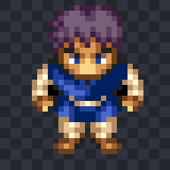
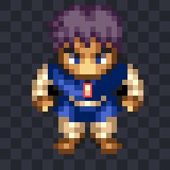
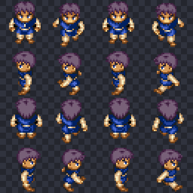
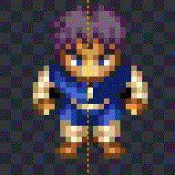
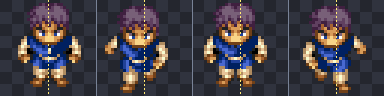
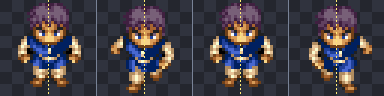

# Pixel Workbench

**A deterministic pixel-art inspection, editing, and quality-assurance toolkit for AI coding agents.**

Pixel Workbench gives AI coding agents and developers structured tools to understand, construct, modify, and validate pixel-art game assets.

Instead of treating pixel art as an unconstrained image-generation problem—which often introduces inconsistent pixel grids ("mixels"), noisy palettes, and broken outlines—Pixel Workbench provides a structured semantic representation of image data (`SpriteAnalysis`), lossless 2D ASCII-grid editing, deterministic geometric drawing operations, context-aware repair rules, and pixel-level regression testing.

Through its Model Context Protocol (MCP) server, compatible AI coding agents can interact with these capabilities directly.

**The goal:** Help AI agents make deliberate, verifiable changes to pixel art while preserving the details, palettes, and frame structure that make the original artwork work.

---

## What It Can Do

- **Inspect:** Analyze palettes, connected components, outlines, color clusters, symmetry, and heuristic semantic regions via `SpriteAnalysis`.
- **Construct:** Build sprites using deterministic drawing operations (`line`, `rect`, `ellipse`, `flood_fill`, outlines, shading) and lossless 2D ASCII grids.
- **Modify:** Apply localized pixel edits to single sprites or multi-frame indexed (`P`-mode) and `RGBA` sprite sheets while preserving unrelated artwork.
- **Repair:** Detect and propose context-aware corrections for common pixel-art defects (`dry_run=True`, `safe=True`).
- **Validate:** Compare changes against named checkpoints using pixel-level diffs and six complementary QA checks.
- **Integrate:** Expose the toolkit through a lightweight MCP `stdio` server for AI coding agents.

---

## Visual Demonstrations

### 1. Deterministic Construction from an ASCII Grid

An agent constructs a 16×16 inventory icon ([`golden_key.png`](golden_key.png)) from scratch using a 2D ASCII character grid and a 5-color hex ramp via `apply_ascii_grid`:

<table>
<tr>
<th>16×16 ASCII Grid &amp; Color Legend</th>
<th>Rendered Asset (8× Nearest-Neighbor Preview)</th>
</tr>
<tr>
<td>

```text
......1111......
....11233311....
...1231111431...
...131....141...
...131....151...
...1441111551...
....11445511....
......1111......
......1341......
......13411.....
......13431.....
......13411.....
......1341......
......134111....
......1343551...
......1111111...
```

- `.` : `transparent`
- `1` : `#2a1d0c` (Dark bronze outline)
- `2` : `#fff6cc` (Specular highlight)
- `3` : `#fed954` (Bright gold)
- `4` : `#dca124` (Midtone gold)
- `5` : `#8c6214` (Shadow gold)

</td>
<td align="center">
  
  <br />
  <sub>Actual output: <code>golden_key.png</code> (16×16 RGBA)</sub>
</td>
</tr>
</table>

---

### 2. Targeted Modification on an Indexed Sprite Sheet

Starting from a 128×128 16-frame indexed (`P`-mode) RPG character sheet ([`test_sprite_sheet.png`](test_sprite_sheet.png)), an agent modifies exactly **2 pixels** (`(16, 16)` and `(16, 17)`) on Frame 0 to add a bright clasp detail to the character's tunic ([`test_sprite_sheet_edited.png`](test_sprite_sheet_edited.png)).

`compare_images` verifies that `changed_pixels == 2`, zero unauthorized colors were introduced, the indexed color table remained intact, and all other 15 animation frames were untouched:

<table>
<tr>
<th align="center">Frame 0 — Original</th>
<th align="center">Frame 0 — Edited (2px Clasp Highlighted)</th>
<th align="center">Full 16-Frame Sheet Preserved</th>
</tr>
<tr>
<td align="center">
  
</td>
<td align="center">
  
</td>
<td align="center">
  
</td>
</tr>
</table>

---

### 3. Diagnosing and Correcting Animation Alignment

When inspecting the 4-frame front-facing walk cycle (`y = 0..31`), semantic bounding-box analysis revealed two issues in [`test_sprite_sheet_edited.png`](test_sprite_sheet_edited.png):
1. The new 2px tunic clasp only existed on Frame 0 and flickered off in Frames 1–3.
2. Frames 1, 2, and 3 (`bbox x = 3..24, 4..25, 5..26`) were offset **2 pixels left** relative to Frame 0 (`bbox x = 6..27`), causing the character to lurch sideways during the walk cycle.

Synchronizing the tunic clasp across all four poses and shifting Frames 1–3 by `+2px` horizontally ([`test_sprite_sheet_edited_animation_ready.png`](test_sprite_sheet_edited_animation_ready.png) / [`test_sprite_sheet_front_128x32.png`](test_sprite_sheet_front_128x32.png)) stabilizes the walk cycle on the frame center axis (`x = 16`):

<table>
<tr>
<th align="center">Before: Misaligned Walk Cycle</th>
<th align="center">After: Centered &amp; Synchronized Walk Cycle</th>
</tr>
<tr>
<td align="center">
  
  <br /><br />
  
  <br />
  <sub>Frames 1–3 drift 2px left of the dashed center axis; tunic clasp disappears after Frame 0.</sub>
</td>
<td align="center">
  
  <br /><br />
  
  <br />
  <sub>All 4 poses stay aligned to the center axis with the tunic clasp synchronized across frames.</sub>
</td>
</tr>
</table>

---

## Installation &amp; Quick Start

### Requirements

- **Python:** `>= 3.8` (tested on Python 3.8–3.12)
- **Operating Systems:** Linux, macOS, and Windows
- **Dependencies:** `Pillow >= 7.0.0` (the MCP `stdio` server uses native Python standard library JSON-RPC 2.0 and requires no external MCP SDK)

### Install from Source

```bash
git clone https://github.com/cobjams/pixel-workbench.git
cd pixel-workbench

python3 -m venv .venv
# On Linux / macOS:
source .venv/bin/activate
# On Windows (PowerShell):
# .venv\Scripts\Activate.ps1

pip install -e .
```

### Try the Command-Line Tools

```bash
# Inspect semantic metrics (palette, clusters, outline, symmetry) and output JSON
python3 -m pixel_workbench analyze golden_key.png

# Output the lossless 2D ASCII character grid and color legend
python3 -m pixel_workbench grid golden_key.png

# Preview proposed context-aware repairs without modifying the file (--dry-run)
python3 -m pixel_workbench repair golden_key.png --dry-run

# Run a pixel diff and QA regression report between two sprites
python3 -m pixel_workbench regression test_sprite_sheet.png test_sprite_sheet_edited.png

# Export a visual diff image and JSON comparison report
python3 -m pixel_workbench diff test_sprite_sheet.png test_sprite_sheet_edited.png --image diff.png --json diff.json
```

### Start the MCP Server

```bash
python3 -m pixel_workbench mcp-serve
# Or using the installed console script:
pixel-workbench mcp-serve
```

### Configure an MCP Client

Add `pixel-workbench` to your MCP client configuration (Claude Code, Cursor, Codex, Antigravity, etc.):

```json
{
  "mcpServers": {
    "pixel-workbench": {
      "command": "python3",
      "args": ["-m", "pixel_workbench", "mcp-serve"],
      "cwd": "/path/to/pixel-workbench"
    }
  }
}
```

---

## Agent-Assisted Asset Workflow

Pixel Workbench is structured around an iterative six-step loop:

1. **Inspect:** Load an image or initialize a `SpriteWorkspace` (`init_workspace` / `inspect_sprite`) to obtain its structured semantic representation (`SpriteAnalysis`: `palette`, `connected_components`, `clusters`, `outline`, `symmetry`, `semantic_regions`) and lossless 2D ASCII grid.
2. **Plan:** Save a named baseline checkpoint (`checkpoint_workspace`) and configure optional QA constraints (`allowed_palette`, `max_colors`, `expected_outline_color`, `preserve_symmetry`, `min_horizontal_symmetry`, `min_vertical_symmetry`, `disallow_new_jaggies`).
3. **Construct / Modify:** Apply edits using 2D ASCII grids (`apply_ascii_grid`), deterministic geometric primitives (`draw_shape`: `line`, `rect`, `ellipse`, `flood_fill`), outlining and directional shading (`auto_outline_and_shade`), or hue-shifted color ramps (`generate_color_ramp`).
4. **Validate:** Run `regression_report` against a checkpoint or reference file to inspect pixel diffs, semantic deltas, and the six QA checks.
5. **Iterate &amp; Repair:** Preview non-destructive repairs (`lint_and_repair` with `dry_run=True, safe=True`), apply safe repairs with `protect_coords`, or roll back via `undo()`.
6. **Export:** Save the verified PNG asset (`save_sprite`), preserving original indexed (`P`) or `RGBA` mode.

---

## Pixel-Art Quality Assurance Checks (`analysis/regression.py`)

Pixel Workbench provides six complementary QA checks that can be run against a baseline checkpoint or reference image to evaluate changes:

| QA Check | Function | What It Evaluates |
| :--- | :--- | :--- |
| **Grid Round-Trip** | `check_grid_roundtrip` | Verifies `Image → ASCII Grid → Image` produces `0` unintended pixel changes (including partial alpha, blank rows, leading/trailing spaces, and palettes >100 colors). |
| **Palette Regression** | `check_palette_regression` | Verifies no unexpected colors were introduced outside the baseline or `allowed_palette` and that `max_colors` is respected. |
| **Outline Regression** | `check_outline_regression` | Verifies that interior colors did not leak onto a previously closed single-color boundary (or `expected_outline_color`), reports corner-double jaggies (`jaggies_before` / `jaggies_after`), and optionally enforces `disallow_new_jaggies` / `max_jaggies`. |
| **Symmetry Validation** | `check_symmetry_validation` | Evaluates horizontal and vertical symmetry against baseline (`preserve_baseline`) or explicit thresholds (`min_horizontal`, `min_vertical`) and pinpoints asymmetric coordinate pairs. |
| **Animation Consistency** | `check_animation_regression` | Checks basic frame-to-frame consistency across a list of frames: identical dimensions, palette consistency, opaque pixel volume delta, center-of-mass shift, and configurable bounding-box anchor stability (`anchor`, `max_anchor_shift`). |
| **Repair Regression** | `check_repair_regression` | Verifies that running `RepairEngine(safe=True)` does not damage valid 1px interior details (eyes, specular highlights), `protect_coords`, or multi-pixel selective-outline accents. |

---

## Safe, Context-Aware Repair Engine (`analysis/repair/`)

- **`RemoveIsolatedPixelsRule`:** Removes asymmetric stray 1px noise while preserving:
  - 1px interior color clusters (eyes, highlights, buttons) surrounded by opaque pixels.
  - Horizontally symmetric 1px detached details (twin sparks, floating particles).
  - Repeated starfield / particle motifs (`>= 3` detached pixels of identical color).
  - Explicitly protected coordinates (`protect_coords`).
- **`StandardizeOutlineColorRule`:** Fixes 1px rogue outline color errors while preserving:
  - Multi-pixel contiguous selective-outline (`sel-out`) accents (e.g., a golden crown rim or glowing tip).
  - Horizontally symmetric outline accents.
  - Borderless sprites where the interior fill naturally forms the outer boundary.
- **Dry-Run Mode (`dry_run=True`):** Returns proposed `modified_pixels` and `preserved_details` without mutating the document.

---

## MCP Server Reference (`tools/mcp_server.py`)

Pixel Workbench includes a lightweight MCP server using native Python JSON-RPC 2.0 over `stdio` (`pixel-workbench mcp-serve`), without requiring an external MCP SDK. It supports both newline-delimited JSON-RPC and `Content-Length` header framing.

### Exposed MCP Tools

| Tool Name | Description |
| :--- | :--- |
| `init_workspace` | Initialize a blank sprite workspace or load an existing PNG with optional QA constraints. |
| `inspect_sprite` | Return structured semantic analysis (`SpriteAnalysis`), validation diagnostics, and the 2D ASCII grid. |
| `apply_ascii_grid` | Paint or patch the sprite via a 2D ASCII grid and character-to-hex legend (`preserve_whitespace`, `strict`). |
| `draw_shape` | Draw deterministic `line`, `rect`, `ellipse` (requires `x0, y0, x1, y1, color`), or `flood_fill` (`x0, y0, color`). |
| `auto_outline_and_shade` | Deterministically generate 1px `outside`/`inside` outlines and directional shading. |
| `lint_and_repair` | Run semantic review and safe/dry-run repairs with optional `protect_coords`. |
| `checkpoint_workspace` | Save a named baseline snapshot of the current workspace for regression comparison. |
| `regression_report` | Run pixel diffing and the QA test suite against a named checkpoint or reference PNG. |
| `generate_color_ramp` | Generate hue-shifted pixel-art color ramps from shadow to highlight. |
| `save_sprite` | Save the active sprite document to disk. |

> **Multimodal Preview Tip:** Passing `"include_preview_image": true` in any `tools/call` request returns an 8× nearest-neighbor upscaled PNG (`type: "image"`, `mimeType: "image/png"`) alongside the structured JSON text payload.

---

## Project Status &amp; Capabilities

### Implemented (Available Now)
- Indexed (`P`-mode) and `RGBA` PNG import/export with palette preservation
- Structured semantic image analysis (`SpriteAnalysis`)
- Lossless 2D ASCII grid serialization and patching (`apply_ascii_grid`)
- Deterministic geometric primitives, outlining, directional shading, and hue-shifted color ramps
- Named workspace checkpoints and pixel-level visual/JSON diffing
- Context-aware safe repair rules with `dry_run` preview and coordinate protection
- Six complementary QA checks (`analysis/regression.py`)
- Native Python `stdio` MCP JSON-RPC 2.0 server and `MCPStdioClient` test client

### Demonstrated Experimentally (Agent-Tested Workflows)
- Constructing a pixel-art inventory asset (`golden_key.png`) from scratch via MCP
- Importing and losslessly round-tripping an indexed 16-frame character sprite sheet
- Applying a localized 2-pixel modification to a character sprite while preserving 15 other animation frames
- Synchronizing decorative details across animation poses
- Diagnosing and correcting frame alignment inconsistencies across a walk cycle

### Planned (Roadmap)
- **Multi-layer compositing:** Named layers (`base_body`, `armor`, `weapon`) on `Document` with non-destructive flattening on export
- **Dedicated MCP frame-slicing tools:** First-class MCP tools exposing `slice_frames` and `assemble_sprite_sheet`
- **Pose-aware animation constraints:** Keypoint/foot-anchor tracking across complex multi-frame animations
- **Onion-skin ASCII comparisons:** Frame-over-frame ASCII overlay diffs for animation tuning
- **Agent benchmark &amp; MCP audit logging:** Standardized benchmark tasks and reproducible JSON-RPC session logs

---

## Running Tests &amp; Troubleshooting

### Run the Test Suite

```bash
python3 -m unittest discover -s tests -v
```

### Troubleshooting

- **`ModuleNotFoundError: No module named 'pixel_workbench'` when running MCP:**
  Ensure you either ran `pip install -e .` inside your active virtual environment or set `"cwd"` in your MCP client config to the repository's parent directory.
- **Colors rejected when editing an indexed (`P`-mode) PNG:**
  Indexed PNGs use a fixed color table. Either use colors already present in the sprite's palette (inspectable via `analyze` or `inspect_sprite`) or convert the image to `RGBA` before introducing new hex colors.
- **ASCII grid alignment shifted on leading spaces:**
  Pass `preserve_whitespace=True` (enabled automatically for `List[str]` grids and grids containing spaces) or use `.` to represent transparent pixels explicitly.
